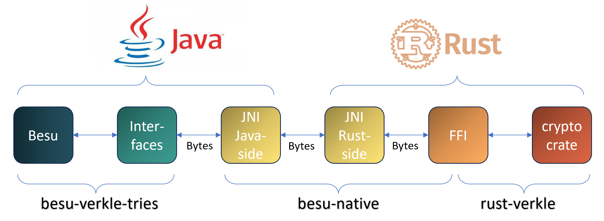

# Besu's Verkle Trie Native Interfaces

Besu's Verkle Trie implements Ethereum's world state, a key-value mapping with keys and values any 32-bytes string.
To insure integrity, blocks include a commitment to the world-state that can be verified.
Verkle Tries is a data structure implementing commitments for large key-value mappings leveraging an underlying small vector commitment scheme.

Besu's Verkle Trie relies on a rust native library for its cryptographic vector commitment.
The native library is from Besu's perspective responsible for vector commitment primitives, but not Verkle Trie's logic.

This specification lay out a simple modular design with interfaces for communications between the modules.


## Modules


Firstly, we have at the ends of the figure the main functionality providers:

- Besu: the main application, a Java library. Responsible for the verkle logic. It works with objects like nodes, addresses, ethereum types.
- Crypto-crate: the main native application, a rust library. It provides cryptographic commitments and related operations. We currently use [rust-verkle](https://github.com/crate-crypto/rust-verkle).

In order to communicate between the two applications, we use JNI. It maps rust functions from/to Java methods, providing entrypoints on both sides: 

- JNI java-side: java class with native methods performing rust function invocation.
- JNI rust-side: rust library exporting functions that take the JNI environment as input to communicate with the JVM.

As the JNI uses lower-level objects such as raw bytes, we include interfaces whose purpose is to manage the passage to and from domain-specific objects.

- Interfaces: java interfaces such as TrieKeyAdaptor and Committer that encapsulates our application layer usecases.
- FFI: rust traits and structures encapsulating its cryptographic layer.

Interposing interfaces between the application layers and the JNI isolates the JNI from applications' details such as elliptic curve elements and ethereum types.

## Cryptographic Functionalities
The native library's purpose is to provide vector commitments primitives underlying Verkle's construction.
Here are the functionalities that it should provide to Besu:

- Commit to a dense/sparse vector of values.
- Commit an update of a committed vector.
- Convert commitment to value (for rolling-up the trie).
- Generate proofs of openings.
- Verify proofs.

### Vector Commitments
We recall what vector commitments do:

- We publish a commitment C to a vector V (in reality, a polynomial).
- The commitment is binding: we cannot (easily) find another vector W producing the same commitment C.
- The commitment is succinct: its size is smaller than the vector itself.
- The commitment is hiding (not important for us): we gain no knowledge of the vector from the commitment.
- We later produce openings V[i] = v, that is a proof P that the ith value of V is v.
- The proof is succinct.
- The proof reveals i and v only, not the rest of the vector (not important for us).
- Given C and P, anyone can verify that V[i] = v.
- Finally, we can create a single succinct proof for many openings at once.

Vector commitments primitives are provided by the native library rust-verkle.

### Verkle Trie
Vector commitments are in practice restricted in size.
Verkle Tries roll-up a much larger vector commitment from a smaller vector commitment primitive.
It recursively computes commitments over previously computed commitments or values until reaching a single root commitment.
It can be thought as Merkle Tries with vector commitments replacing hashes.

Verkle Tries primitives are provided by besu-verkle-tries.

## Communication
For simplicity, the interfaces (Interfaces, JNI and FFI) follow these rules:

- Data is passed between interfaces as little-endian bytes, always.
- Interfaces main purpose is to prepare I/O and delegate to an appropriate module, minimizing coupling.
- Type conversions are checked early. All other operations should be safe. This avoids multiplying error propagation between modules.

### FFI Types
We propose in this section types reflecting the different objects that are used in the interfaces. These types are always little endian bytes.

#### Commitments
Commitments are theoretically banderwagon elements coming from elliptic curve points.
There are two ways to serialise/deserialise a commitment reflected by the following types:

- CommitmentBytes: 64-le-bytes representing an uncompressed commitment.
- CommitmentBytesCompressed: 32-le-bytes representing a compressed commitment.

The difference between uncompressed and compressed serialisation is a matter of trade-off between memory and computation.
Compressed commitments are half the size, but deserialisation is more costly. The interface include conversions between the two.

#### Scalar Field Elements
Values that can be committed to are theoretically elements from the banderwagon scalar field, a prime field.

- ScalarBytes: 32-le-bytes representing a value (a scalar).

Note that commitments themselves need to be recursively committed to in Verkle Tries.
There is a map from commitments to scalars, but one cannot always retrieve uniquely a commitment from its scalar.

### JNI Conversions
We want to do conversions once to catch potential errors early and avoid many error propagation between the different layers.
The JNI java-side uses bytes, but on the rust-side uses our FFI-types.
The JNI is solely responsible for the conversions between its two sides.
Only conversions should potentially raise errors, other operations should be safe.

#### Commitments

```rust
// Tries to create a CommitmentBytes from bytes, else throws an Error.
pub fn try_commitment_from(bytes: &[u8]) -> Result<CommitmentBytes, Error>;

// Tries to create a vector of CommitmentBytes from bytes, else throws an Error.
pub fn try_commitment_vec_from(bytes: &[u8]) -> Result<Vec<CommitmentBytes>, Error>;
```

#### Scalar Field Elements

```rust
// Tries to create a ScalarBytes from bytes, else throws an Error.
pub fn try_scalar_from(bytes: &[u8]) -> Result<ScalarBytes, Error>;

// Tries to create a vector of ScalarBytes from bytes, else throws an Error.
pub fn try_scalar_vec_from(bytes: &[u8]) -> Result<Vec<ScalarBytes>, Error>;
```

#### Safe Conversions
```rust
pub fn compress_commitment(commitment: CommitmentBytes) -> CommitmentBytesCompressed;

pub fn commitment_to_scalar(commitment: CommitmentBytes) -> ScalarBytes;

// Optimised vector version
pub fn map_commitment_to_scalar(commitments: Vec<CommitmentBytes>) -> Vec<ScalarBytes>;
```

## Functionalities

### Rust
#### Committing

```rust
pub trait commit {
    // Commit to a dense vector of values
    pub fn commit(&self, values: Vec<ScalarBytes>) -> CommitmentBytes;
    // Commit to a sparse vector of values
    pub fn commit_sparse(&self, values: HashMap<u8, ScalarBytes>) -> CommitmentBytes;
}
```

#### Updates
For representing updates, we will need to keep track of the old and new values, which are recorded in the following type:

```rust
pub struct ScalarBytesDelta {
    pub old: ScalarBytes,
    pub new: ScalarBytes,
}

pub trait commit_update {
    // Commit an update of a single value
    pub fn commit_update(&self, commitment: CommitmentBytes, delta: ScalarBytesDelta, index: u8) -> CommitmentBytes;
    // Commit an update of a sparse vector of values
    pub fn commit_update_sparse(&self, commitment: CommitmentBytes, deltas: HashMap<u8, ScalarBytesDelta>) -> CommitmentBytes;
}
```

### JNI
Verkle Trie makes use of commitments for several different usecases: trie keys, committing values, committing child commitments, committing stem data and state root.

All the usecases could be covered by 32-bytes values, but for optimisation purposes, we allow values of possibly smaller fixed-size bytes, given as a parameter.

```Java
public static native byte[] commit(byte byte_size, byte[] input);
```

```rust
#[no_mangle]
pub extern "system" fn Java_org_hyperledger_besu_nativelib_ipamultipoint_LibIpaMultipoint_commit(
    env: JNIEnv, _class: JClass<'_>, byte_size: u8, values: jbyteArray
) -> jbyteArray; 
```

### Java-Interfaces
Interfaces on Java-side allow Besu to work at a higher-level, not knowing JNI's formats of communication between Java and rust.

```Java
// TODO: update this section.

// Compressed commitment of 5 16-le-bytes values.
// This will change to use mapCommitmentToScalar.
public Bytes32 trieKey(address: Bytes, index: Bytes32);

// Convert to 17-le-bytes values for commitment.
public byte[] updateLeafValues();

// Convert to 32-le-bytes values for commitment.
public byte[] updateInternalValues();

// Receives a commitment, both uncompressed and compressed.
public Bytes32[3] commitment(input: byte[96]);
```
